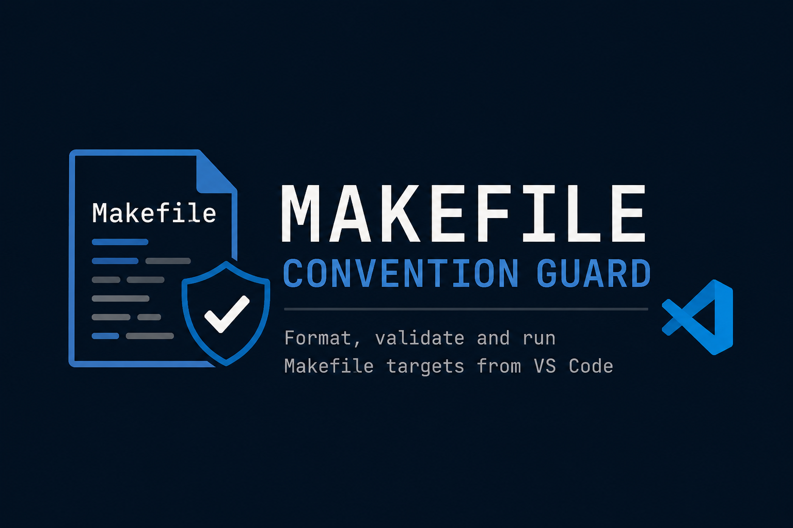

<p align="center">
  
</p>

<p align="center">
  VS Code extension for checking, browsing and running <strong>Makefile</strong> targets.<br/>
  Includes configurable diagnostics, quick fixes, favorites and command execution.
</p>

---

<h2 align="center">Technologies Used</h2>

<p align="center">
  
  
  
  
  
  
</p>

---

# Makefile Convention Guard

VS Code extension for Makefile diagnostics and target workflows directly in the editor.

## 📚 About

**Makefile Convention Guard** is a Visual Studio Code extension focused on improving the maintainability of Makefiles used in project workflows.

The extension combines Makefile validation with a tree view for browsing and running targets:

* configurable whitespace diagnostics and quick fixes;
* Makefile and target trees in the Activity Bar;
* manually adding Makefiles from the current workspace;
* pinning targets to a separate favorites view;
* running targets as VS Code tasks;
* using the Node version configured by mise when a mise project config is present;
* target tooltips from inline `##` descriptions.

The project was created to enforce simple and practical Makefile conventions while keeping the rules configurable, testable and easy to evolve.

## ✨ Features

Current features:

* Validate trailing whitespace in Makefiles.
* Detect multiple consecutive blank lines.
* Detect missing final newline at the end of the file.
* Detect blank lines between a Makefile target and its first recipe command.
* Register diagnostics in the VS Code **Problems** panel.
* Provide quick fixes to remove trailing whitespace, reduce extra blank lines, add the final newline and remove blank lines before recipe commands.
* Add Makefiles manually to the **Makefiles** view. Automatic discovery is temporarily disabled.
* Browse targets under each Makefile and pin frequently used targets to **Favoritos**.
* Show the Makefile relative path beside favorite targets.
* Use the inline pin and play actions to favorite or run a target.
* Open a Makefile's `...` menu to reload its targets or remove it from the view. Removing it does not delete the file or its saved favorites.
* Show a target's description as a tooltip when its rule uses an inline `##` comment.
* Run targets through VS Code tasks. If a mise configuration is found in the Makefile directory or a parent directory, the extension runs `make` through `mise exec`.

Future improvements:

* Validate Makefile section headers.
* Validate helper sections using `##@`.
* Format Makefiles using project conventions.

## 🧭 Browsing and Running Targets

Open the **Makefiles** icon in the Activity Bar and choose **Add Makefiles** to select one or more Makefiles inside the workspace. Automatic discovery is currently disabled, so Makefiles must be added manually.

Expand a Makefile to see its targets. Use the pin action to add a target to **Favoritos**, then run it with the play action. The **...** menu on a Makefile provides **Recarregar comandos do Makefile** and **Remover Makefile da lista**. Removing a Makefile from the view does not delete it from disk; its favorites remain saved.

Add an inline `##` comment to the target rule to show a description in its tooltip:

```makefile
.PHONY: build
build: ## Compile the application
	npm run build
```

Targets run as VS Code tasks. By default, the working directory is the directory containing the Makefile. Set `makefileConventionGuard.execution.cwd` to `workspaceRoot` to run from the workspace root instead. When a mise config such as `.mise.toml` or `mise.toml` is found in the working directory or its parents, the task uses `mise exec -- make ...` so project tools such as Node are available at the configured versions.

## 📂 Repository Structure

```text
makefile-convention-guard/
├── assets/
│   ├── makefile.svg
│   └── thumb.png
├── src/
│   ├── config/
│   │   └── getDiagnosticSettings.ts
│   ├── diagnostics/
│   │   ├── createDiagnostic.ts
│   │   ├── message.ts
│   │   ├── registerDiagnostics.ts
│   │   ├── validateMakefileStyle.ts
│   │   └── rules/
│   │       ├── whitespaceAnalyzer.ts
│   │       └── whitespaceRules.ts
│   ├── makefile/
│   │   ├── discovery.ts
│   │   ├── parser.ts
│   │   └── selection.ts
│   ├── targets/
│   │   ├── MakefileTreeProvider.ts
│   │   ├── TargetFavorites.ts
│   │   ├── makeTargetExecution.ts
│   │   ├── registerTargetView.ts
│   │   └── runMakeTarget.ts
│   ├── tests/
│   │   ├── suite/
│   │   │   └── targetTree.test.ts
│   │   └── unit/
│   │       ├── makeTargetExecution.test.ts
│   │       ├── targetFavorites.test.ts
│   │       ├── targetParser.test.ts
│   │       └── whitespaceAnalyzer.test.ts
│   ├── types/
│   │   └── diagnostics.ts
│   ├── utils/
│   │   └── lineUtils.ts
│   ├── constants.ts
│   └── extension.ts
├── dist/
├── package.json
├── package-lock.json
├── tsconfig.json
├── README.mdx
└── .gitignore
```

## 🚀 Technologies

* Visual Studio Code Extension API
* TypeScript
* Node.js
* Mocha
* Makefile
* Git
* GitHub

## 🎯 Project Objectives

* Create a VS Code extension for Makefile convention enforcement.
* Provide simple and configurable lint rules for Makefiles.
* Improve consistency across Makefile-based project workflows.
* Keep the extension modular, testable and easy to extend.
* Use TypeScript to improve type safety and maintainability.
* Support common Makefile command workflows from a VS Code interface.
* Prepare the project for CI using fast unit tests.

## ⚙️ Development Setup

Install dependencies:

```bash
npm install
```

Compile the extension:

```bash
npm run compile
```

Run TypeScript type checking without emitting files:

```bash
npm run check
```

Watch TypeScript files during development:

```bash
npm run watch
```

## 🧪 Running Tests

The project uses **Mocha** for unit tests and VS Code Extension Host tests.

The whitespace validation logic is split into a pure analyzer module so it can be tested without starting the VS Code Extension Host.

Run unit tests:

```bash
npm run test:unit
```

Run the default test command:

```bash
npm test
```

Run the VS Code Extension Host tests:

```bash
npm run test:extension
```

Recommended validation before committing:

```bash
npm run check
npm run compile
npm run test:unit
```

Current test coverage includes:

* trailing whitespace;
* multiple consecutive blank lines;
* missing final newline;
* blank line before recipe command;
* disabled diagnostics;
* disabled individual whitespace rules;
* target parsing and inline descriptions;
* favorite persistence and duplicate target names across Makefiles;
* mise detection and Make command construction;
* target tooltips in the VS Code Extension Host suite.

## 🧪 Running the Extension Locally

Open the project in VS Code and press:

```text
F5
```

This opens a new **Extension Development Host** window.

The extension activates on startup or when one of its views opens. Open the **Makefiles** view and add a Makefile manually to browse its targets.

To test diagnostics, open a file recognized as `makefile`, such as:

```text
Makefile
```

## 🔍 Diagnostics

The current diagnostic rules focus on whitespace conventions.

### Trailing whitespace

Warns when a line ends with unnecessary spaces or tabs.

```makefile
NODE_VERSION := 22   
```

### Multiple blank lines

Warns when there are two or more consecutive blank lines.

```makefile
NODE_VERSION := 22


DOCS_DIR := docs
```

### Missing final newline

Warns when the file does not end with a final newline.

### Blank line before recipe command

Warns when there is a blank line between a Makefile target and its first recipe command.

Invalid format:

```makefile
test:

	mise install
```

Expected format:

```makefile
test:
	mise install
```

## 🛠️ Available Scripts

```json
{
  "compile": "tsc -p ./",
  "watch": "tsc -watch -p ./",
  "check": "tsc --noEmit -p ./",
  "test:unit": "npm run compile && mocha \"dist/tests/unit/**/*.test.js\"",
  "test": "npm run test:unit",
  "vscode:prepublish": "npm run compile"
}
```

## 🧭 Versioning Roadmap

### v1.0.0

Initial version focused on:

* project structure;
* TypeScript build configuration;
* Makefile diagnostics registration;
* simplified whitespace lint rules;
* pure whitespace analyzer;
* unit tests for whitespace diagnostics;
* quick fixes for common whitespace issues.

### Future versions

Planned improvements:

* Makefile formatter;
* automatic Makefile discovery;
* richer Makefile section and helper validation;
* broader Extension Host coverage.

## 👨‍💻 Author

### Allef Oliveira Ramos

* GitHub: https://github.com/allef-oliveira
* Repository: https://github.com/allef-oliveira/makefile-convention-guard

## 📄 License

This project is licensed under the ISC License.
